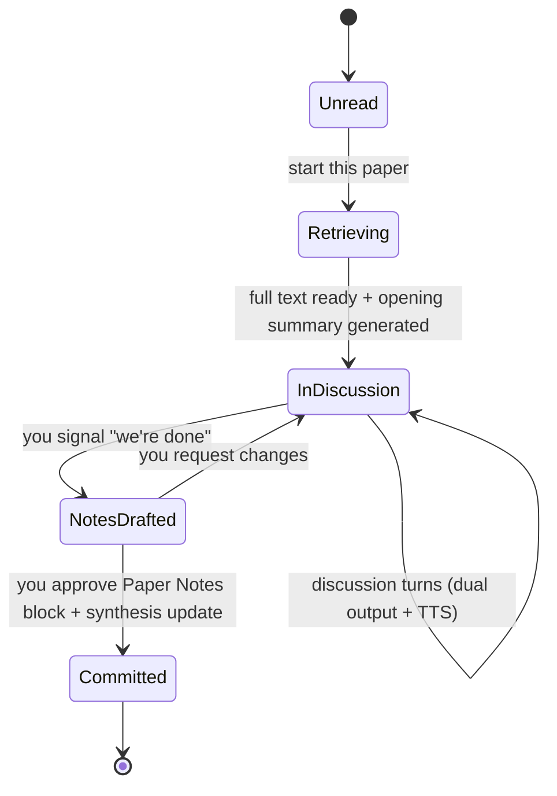
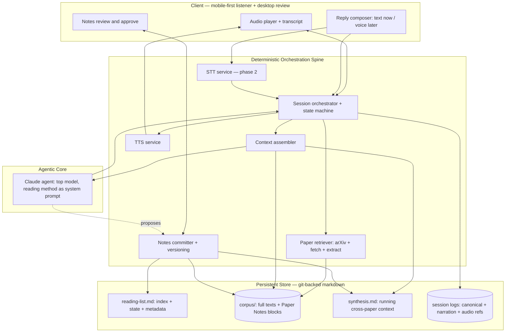
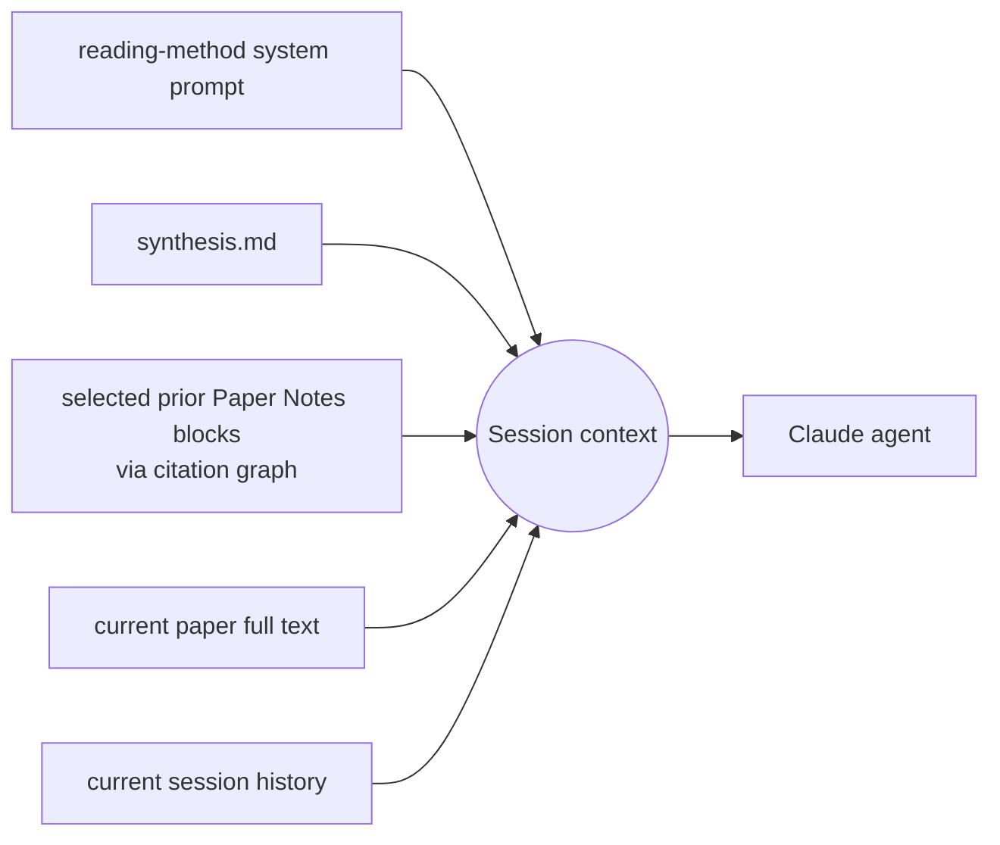

# Research Reading Companion — Initial Architecture & Plan

> **Initial plan — 2026-06-16.** This is the original design document that kicked off the
> project, preserved verbatim below. The implementation has since evolved and moved past
> several specifics here — e.g. the agentic core runs on **OpenRouter** (not the Claude Agent
> SDK), the dual output is generated in **two stages** (analysis model → a separate faithful
> TTS-narration model) and **streamed**, speech uses **OpenAI single-file mp3** behind a
> pluggable interface, the aggregate notes are now called **Project Notes** with a dedicated
> cross-paper **Project Notes Review** chat, and there's an editable-prompt system, a
> favorite-model switcher, and a neon web UI. Treat this as the founding plan of record; the
> code and git history reflect the current system.

---

# Research Reading Companion — Architecture Design

*A system for reading a paper corpus with Claude: scholarly discussion, listen-friendly audio, and notes that compound into the context for the next paper.*

---

## 1. Purpose and design principles

The goal is a seamless loop in which you talk to a Claude agent that holds the entire reading project in mind — the reading list, the reading method, and everything learned so far — discusses a paper with you at research depth, hands you listen-friendly audio for the walk or the drive, and folds each paper's findings back into a persistent notes file that becomes the context for the next session. The agent and you read the corpus together with near-universal context throughout the journey.

Four principles shape every decision below.

**Separate the mechanical from the cognitive.** Most of your current workflow is deterministic plumbing — fetching a paper, converting text to speech, capturing a reply, writing to a file. Exactly one part is cognitive: the reading partner itself. The architecture draws a hard line between a *deterministic orchestration spine* and an *agentic core*, so each can be built, tested, and swapped independently.

**The agent proposes; the human commits.** The agent never silently writes to your notes. It drafts Paper Notes blocks and synthesis updates, and the spine commits them only after you approve. Your project file stays trustworthy because nothing enters it without your sign-off.

**Context economy over context maximalism.** "Feed the whole notes file every session" works for paper three and breaks by paper eighteen. The design keeps the durable record complete but assembles each session's context from a curated slice: a compact running synthesis plus the specific prior Paper Notes blocks that are actually relevant, selected using the citation graph the reading list already encodes.

**Generate for the record and for the ear in one pass.** Your current Gemini rewrite hop disappears. Each agent turn emits two aligned outputs — a canonical scholarly version (equations, quotes, figure references, links) that goes into the record, and a narration script written for listening. One model, one generation, no second vendor, no quality loss, and it is deterministic which version goes to TTS.

---

## 2. The paper lifecycle as a state machine

Every paper moves through an explicit set of states. The spine always knows which state a paper is in and therefore which handoff comes next — what it can automate versus what it must hand to you.



`Unread` and `Committed` are the only states that persist the reading-list status you already use (`unread` / `read`). `Retrieving`, `InDiscussion`, and `NotesDrafted` are transient working states the orchestrator manages within and across sessions. Because a paper can sit in `InDiscussion` for days across many short sessions, the backbone must be able to pause and resume a session cleanly — which is the single most important constraint on the tech choice in Section 11.

---

## 3. High-level architecture

Four layers: a client you interact with, a deterministic spine that orchestrates everything mechanical, an agentic core that does the reading, and a git-backed store that is simultaneously the corpus, the notes, and the "project instructions" file fed into future sessions.



The client is deliberately thin: it plays audio, shows the transcript, takes a reply, and lets you approve notes. All intelligence lives server-side so the same backend can serve a phone on a walk and a laptop at a desk without duplicating logic.

---

## 4. The deterministic / agentic boundary

This table is the contract between the two halves of the system. If a capability is in the left column it never calls a language model; if it is in the right column it never touches a file directly.

| Deterministic spine (no LLM) | Agentic core (Claude) |
|---|---|
| Retrieve, fetch, and clean paper full text | Produce the opening comprehensive summary |
| Assemble session context per the selection rules | Conduct the scholarly discussion, Q&A, critique |
| Convert narration scripts to audio (TTS) | Emit the dual output (canonical + narration) each turn |
| Deliver and cache audio; capture replies | Draft the Paper Notes block at completion |
| Manage state transitions and session resume | Propose updates to the running synthesis |
| Commit approved Notes/synthesis edits, with version history | Identify which prior papers are relevant (hybrid with the spine) |
| Select relevant prior Notes via the citation graph | — |

The one shared responsibility — deciding which earlier papers matter for the current one — is handled as a hybrid: the spine proposes candidates deterministically from the citation links recorded in the reading list, and the agent confirms or extends that set using its understanding of the discussion. This keeps context selection cheap and explainable while still allowing the agent to pull in a non-obvious connection.

---

## 5. Turn-level data flow

A single discussion turn is the heartbeat of the system. The sequence below shows where the dual output lands and why no second model is needed.

```mermaid
sequenceDiagram
  participant U as You
  participant S as Spine
  participant C as Claude (agent)
  participant T as TTS

  U->>S: Reply (typed now; spoken later)
  S->>S: Assemble context (synthesis + relevant Notes + paper text + history)
  S->>C: Send turn
  C-->>S: Dual output { canonical, narration }
  S->>S: Append canonical to session log (the record)
  S->>T: Send narration script
  T-->>S: Audio file / stream
  S-->>U: Push audio + transcript
  Note over U: listens on the walk, composes the next reply
```

The canonical version is the artifact of record: it carries the equations, the under-15-word quotes, the figure callouts ("see Figure 5"), and any links, and it is what later gets distilled into the Paper Notes block. The narration version is what your ears receive. They are produced together and stay semantically aligned because one model wrote both in the same breath.

---

## 6. The dual-output contract

Each agent turn returns a small structured object rather than a single blob of prose. A minimal shape:

```json
{
  "canonical": "Full scholarly response: equations, quotes, figure references, links.",
  "narration": "Spoken-word script: equations read aloud, no markdown, no links, figure callouts phrased as 'make a note to look at Figure 5 later'.",
  "state_signal": "in_discussion | ready_to_draft_notes",
  "proposed_commit": null
}
```

The narration script follows explicit rules enforced by the system prompt: render equations in words (for example, "the attention score is the softmax of q-dot-k over the square root of d" rather than a LaTeX line), drop markdown and inline references, convert figure mentions into spoken reminders, and keep sentences short enough to survive text-to-speech prosody. When the agent judges that the paper has been worked through, it sets `state_signal` to `ready_to_draft_notes`; when you approve a draft, the agent's next turn populates `proposed_commit` with the Paper Notes block and any synthesis edit, which the spine routes to the committer.

Producing both in one structured response is what removes the Gemini hop, the second vendor, and the drift between what you read and what you hear.

---

## 7. Context and memory strategy

This is the part that determines whether the system still works at paper eighteen. The durable record stays complete; the *working context* for any given session stays small and relevant.

Three tiers of memory:

The **durable record** is the Paper Notes block plus the cached full text, one file per paper. Nothing is ever lost here.

The **running synthesis** (`synthesis.md`) is a single compact document the agent maintains: the live cross-paper threads (for example, "the disaggregation line versus Sarathi-Serve's chunked-prefill stance"), recurring groups and authors, open questions carried forward, and corrections you have made. It is rewritten, not appended, so it stays short and current rather than growing without bound. This is the closest thing to your "universal context."

The **selected prior Notes** are pulled per session using the citation graph the reading list already encodes. When you start a new paper, the spine reads which list-papers it cites and loads exactly those Paper Notes blocks — which is precisely what the reading method's "situate this paper relative to the others" instruction needs anyway. The selection rule and the reading requirement are the same rule.

A session's assembled context is therefore: the reading-method system prompt, the running synthesis, the selected prior Paper Notes blocks, the full text of the current paper, and the current session's own history. Not the raw everything. As the corpus grows, only the synthesis and the selected-Notes set grow, and both are bounded by design.



---

## 8. The persistent store

The store is plain markdown in a git repository. That choice is deliberate: the files are human-readable, every commit is a diff you can inspect or revert, and the same repository *is* the project file you already maintain. The agent's filesystem-based configuration can read it directly.

Layout:

```
project/
  reading-list.md         # the index: groups, entries, metadata, status, citation links
  synthesis.md            # running cross-paper context (rewritten each commit)
  corpus/
    vllm-pagedattention.md # full text + metadata + the Paper Notes block once read
    orca.md
    ...
  sessions/
    2026-06-15-vllm.jsonl  # turn-by-turn log: canonical + narration + audio refs
```

`reading-list.md` keeps doing what your current project instructions do, with one addition: an explicit, machine-readable citation field per entry (which other list-papers it cites and the relationship), so the spine can drive context selection without re-deriving it each time. Each `corpus/<paper>.md` holds the cleaned full text and, after reading, the appended Paper Notes block — so a paper's notes physically travel with its text. The `sessions/` logs preserve both output channels and the audio artifact references, which makes any past discussion replayable as audio without regenerating it.

A commit at paper completion is a single reviewable change set: flip status to `read` in the index, append the Paper Notes block to the paper's file, and rewrite the relevant portion of `synthesis.md`. You approve that change set the way you would approve a pull request.

---

## 9. Session flows

**Starting a new paper.** You name the next paper (or accept the next `unread` entry). The orchestrator moves it to `Retrieving`, the retriever resolves it on arXiv, fetches and extracts the text, and caches it under `corpus/`. The assembler builds the opening context (synthesis + cited prior Notes + full text), and the agent produces the opening comprehensive summary as a dual output. You receive audio; the canonical summary is logged. The paper is now `InDiscussion`.

**A discussion turn.** Exactly the loop in Section 5, repeated as many times as the paper warrants, possibly spread across several short sessions. Because the backbone resumes paused sessions cleanly, "I'll continue after lunch" costs nothing — the session state, including the assembled context and history, is preserved server-side.

**Completing a paper.** When you signal you are done, the agent drafts the Paper Notes block (key findings and learnings, in the style your reading method specifies) and proposes the synthesis edit. You review both on the desktop surface, request changes if needed, and approve. The committer writes the change set; the paper becomes `Committed` / `read`.

**Handoff to the next session.** Nothing special is required — the next paper simply assembles its context from the now-updated synthesis and the now-existing Paper Notes blocks. The compounding is automatic: each paper you finish enriches the context the next one starts from.

---

## 10. Audio pipeline

For "listen now," the spine sends the narration script to a TTS provider behind a thin interface and returns an audio file plus the transcript to the client. Audio is cached against the session log so re-listening never re-synthesizes. The TTS provider sits behind an interface precisely because quality is the thing you were unhappy with — it must be swappable without touching anything else.

For "voice later," the seam is already drawn. The reply composer currently sends text; in phase 2 it sends audio to an STT service that transcribes to the same text channel the orchestrator already consumes. Nothing downstream of the transcription changes. The full hands-free loop — listen, speak a reply, listen again — becomes a client and STT addition, not an architectural change.

---

## 11. Recommended tech stack

Each box below is a recommendation, and every external service is pluggable.

**Agentic core.** Build the agent on the **Claude Agent SDK** (Python) for local development and prototyping — it provides the agent loop, automatic context compaction, tool use, and filesystem/skill-based configuration, so the reading method lives as project configuration the agent loads directly. For production, the strongest fit is **Claude Managed Agents**, whose sessions are stateful and resume cleanly after pauses — which is exactly the multi-day, pick-up-where-you-left-off pattern this workflow has. The documented path of prototyping on the SDK and graduating to Managed Agents matches the phasing below. Use the top Claude model for discussion.

**Paper retrieval.** The arXiv API for resolution and metadata, a PDF text extractor for the full text, and a general web-fetch fallback for non-arXiv sources. Cleaning (stripping headers, fixing broken equation glyphs) is a deterministic post-step.

**Persistent store.** Markdown in a git repository, as in Section 8. Optionally a lightweight local index for citation-graph lookups if the reading list grows large, but for a corpus this size, parsing the index file directly is enough.

**TTS (now).** Pluggable behind an interface; pick on voice quality. Reasonable candidates to evaluate are a premium neural voice provider for naturalness versus a cloud platform TTS for cost and latency. Decide after a quick listening test rather than on paper.

**STT (phase 2).** A streaming speech-to-text service behind the same reply channel.

**Client.** Mobile-first for the listening surface — a cross-platform framework or a progressive web app with a solid background audio player and a reply composer — plus a desktop/web review surface for the notes-approval and deep-session work, both talking to the same backend.

**Orchestration.** For the MVP, a simple state field on each paper plus a job runner is enough. If you later want strong guarantees around long-paused, resumable sessions and retries, a durable workflow engine is the natural upgrade — but only adopt it when the simple version actually hurts.

---

## 12. Phased build plan

**Phase 0 — Automate your current loop (MVP).** A single-user backend, no app yet. The Agent SDK runs locally with the reading method as its configuration; the dual-output prompt replaces the Gemini rewrite; notes live as markdown in git; one TTS provider generates audio files you play manually; you trigger sessions and type replies. This alone removes the manual Gemini hop and the formatting cleanup, and it proves the dual-output contract and the notes/synthesis loop end to end.

**Phase 1 — The custom app.** Add the mobile client and the backend service, move to Managed Agents for stateful resume, stream or push audio when narration is ready, and let you review and approve Notes and synthesis edits from the app. Wire in citation-graph context selection so each new paper auto-loads the right prior Notes.

**Phase 2 — Voice and generalization.** Add STT for spoken replies and close the hands-free loop. Then generalize beyond this one project: make the reading method a swappable template and support multiple corpora, so the same machine reads any reading list, not just this one.

---

## 13. Deferred decisions

A handful of choices do not change the architecture and can be settled later: the final TTS vendor (decide by listening test); hosting (local-first versus a small cloud deployment); whether to run the production agent loop yourself on the SDK or hand it to Managed Agents; how aggressively to cache audio for offline listening; and whether the system stays single-user or eventually supports a small group reading the same corpus together. None of these block Phase 0.

---

*Open question for you before any build starts: do you want Phase 0 to stay a personal command-line tool you run by hand, or should even the MVP expose a minimal mobile listening surface? That single choice decides whether we start with backend-only plumbing or stand up a thin client in parallel.*
